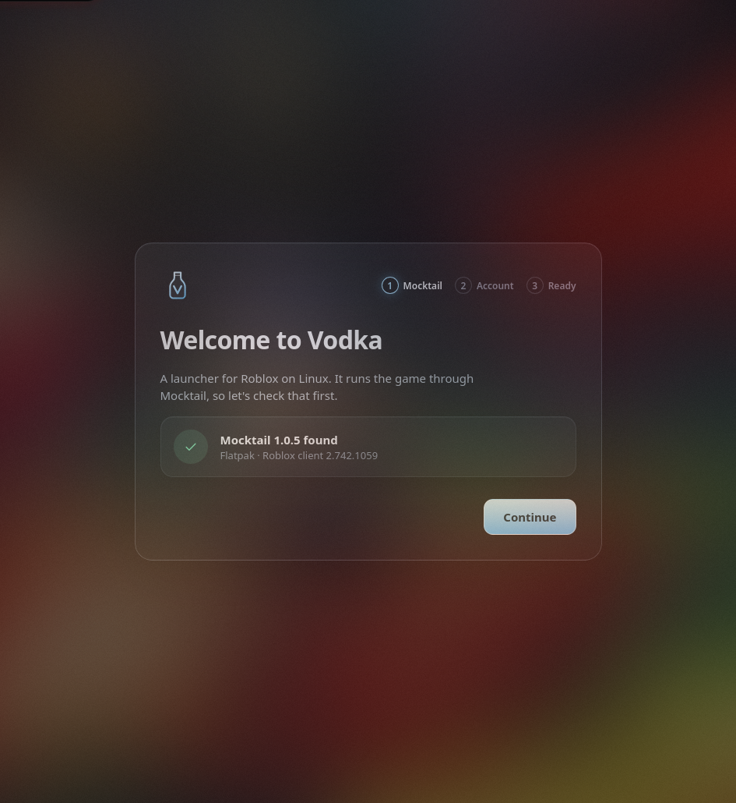

# Vodka Launcher

A launcher for Roblox and [Luduvo](https://luduvo.com) on Linux. For Roblox, Vodka is the front end and [Mocktail](https://github.com/komaruworld/mocktail) is the engine that runs the game; for Luduvo it drives Luduvo's official launcher. A rail on the left switches between the two.



**Status:** phase 4 of 5. Home, Games, Players, Avatar, Marketplace, Friends and Chat all exist. Trades, the second-screen HUD, macros and packaging are not built.

## What it does today

- Finds the Mocktail Flatpak (`space.bigrat.mocktail`) and tells you how to install it if it's missing.
- Signs you in on Roblox's own login page. The session goes into the system keyring (Secret Service) and nowhere else.
- Shows "Continue playing" and "Favorites" with a Play button that starts Mocktail in that game.
- Shows Mocktail's output while it starts, and the reason if it crashes.
- Keeps several accounts, each with its own isolated Mocktail profile, and switches between them.
- Runs several games at once (up to 10), one per account, with FPS, CPU and memory per game.
- Searches all of Roblox and shows the public charts.
- Shows your friends, what they're playing, and friend requests; joins a friend's server when Roblox shares it.
- Has its own opt-in chat and parties (up to six) between Vodka users, with game invites.
- Switches between your saved avatar outfits, edits what you wear, and browses the avatar catalog.
- Buys fixed-price catalog items with your Robux, only after you confirm the exact price in a dialog.
- Sets frame rate, graphics and FFlags for all accounts or per account, and can hold or roll back the Roblox client.

Running more than one Roblox client at once is not supported by Mocktail's developers and is against Roblox's Terms of Use. Vodka warns
before the first time; the risk to your accounts is yours.

Not yet: AUR, system-package and AppImage installs of Mocktail are not detected.

## Install

Download the latest `vodka-launcher-…-x86_64.AppImage` from [Releases](https://github.com/AriCuteGirl/vodka-launcher/releases), then:

```bash
chmod +x vodka-launcher-*-x86_64.AppImage
./vodka-launcher-*-x86_64.AppImage
```

It needs nothing else installed besides Mocktail and a keyring. If it won't start with a FUSE error, install `fuse2`
(or run it with `--appimage-extract-and-run`). It needs glibc 2.39 or newer (Ubuntu 24.04, Debian 13, Fedora 40
and later). To build the release AppImage yourself: `./scripts/build-appimage-ubuntu.sh` (needs Docker), or
`./scripts/build-appimage.sh` for one that only runs on systems as new as yours.

**NixOS / Nix:** use the flake. It runs the release AppImage, so nothing is compiled:

```bash
nix run github:AriCuteGirl/vodka-launcher
```

To install it for good, add the flake to your system flake's inputs and the package to your packages:

```nix
# flake.nix
inputs.vodka-launcher.url = "github:AriCuteGirl/vodka-launcher";

# configuration.nix (pass `inputs` through specialArgs)
environment.systemPackages = [ inputs.vodka-launcher.packages.${pkgs.stdenv.hostPlatform.system}.default ];
```

You also need `services.flatpak.enable = true;` (for Mocktail) and a keyring, for example
`services.gnome.gnome-keyring.enable = true;`. `nix flake update vodka-launcher` gets the newest version.
To build from source instead, use the `vodka-launcher-source` package (slow, and needs a CPU with AVX).

**Windows:** download `vodka-launcher-…-windows-x64.zip` from the same Releases page, unzip it and run
`Vodka Launcher.exe`. See [docs/WINDOWS.md](docs/WINDOWS.md).

## Requirements

- Linux with Flatpak and Mocktail (`flatpak install flathub space.bigrat.mocktail`)
- A running Secret Service keyring (GNOME Keyring, KWallet, KeePassXC)
- To run a release: `webkit2gtk-4.1`, `gtk3`, `libsoup3` and `libsecret` (most desktops have them)
- To build: Rust 1.88+, Node 22+, pnpm, and Tauri's Linux dependencies (`webkit2gtk-4.1`)

## Run and build

```bash
pnpm install
pnpm tauri dev      # run the desktop app
pnpm tauri build    # build an AppImage
```

```bash
pnpm dev            # UI only in a browser, with demo data
pnpm check          # type-check
pnpm test           # UI unit tests
cd src-tauri && cargo test   # backend tests
```

The browser-only UI accepts `?demo=` to show a state: `loading`, `empty`, `error`, `ratelimited`, `offline`, `expired`,
`nomocktail`, `noflatpak`, `running`, `crash`, `signedout`, `onboarding`.

## Layout

| Path | What |
|---|---|
| `src-tauri/src/mocktail` | Find Mocktail, start it, read its output and exit |
| `src-tauri/src/accounts` | Login window and keyring storage, one entry per account |
| `src-tauri/src/instances` | Running games: per-account profiles, slots, CPU/RAM, stop and restart |
| `src-tauri/src/roblox_api` | Typed Roblox web API client: host allowlist, cache, backoff |
| `src-tauri/src/chat.rs` | Client for Vodka's own chat server |
| `server/supabase` | The chat server: database migration and edge function |
| `src-tauri/src/tweaks.rs` | Launch options and FFlag validation, mapped to Mocktail's environment variables |
| `src-tauri/src/settings.rs` | Non-secret preferences |
| `src/lib` | UI: design tokens, components, state |
| `src/routes` | Pages |

## Privacy and safety

- Vodka contacts `*.roblox.com` and Roblox's image CDN for thumbnails. No telemetry.
- **Vodka chat is the one exception, and it is off until you turn it on.** It talks to Vodka's own chat server (a Supabase
  project, source in `server/`). That server receives your Roblox user id, your public names, and the messages and game
  invites you send. It never receives your Roblox session. You prove an account is yours by putting a phrase in your public
  Roblox profile. Messages are deleted after 14 days, and you can delete your chat account from the Chat page.
- Roblox does not filter or moderate Vodka chat. Only people you add with a Vodka code can message you.
- Your Roblox session is an account key. Vodka keeps it in the keyring, never logs it, and hides any log line that contains one.
- No exploits, executors, script injection, or anything that touches Roblox's anti-cheat.

## License and credits

Apache-2.0, see [LICENSE](LICENSE) and [NOTICE](NOTICE). Vodka runs Mocktail (Apache-2.0, Mocktail Project Authors) as a separate
program and does not bundle it or the Roblox client.

Vodka Launcher is an independent project. It is not affiliated with Roblox Corporation, Luduvo Corporation, Mocktail, or Lunar Client.
